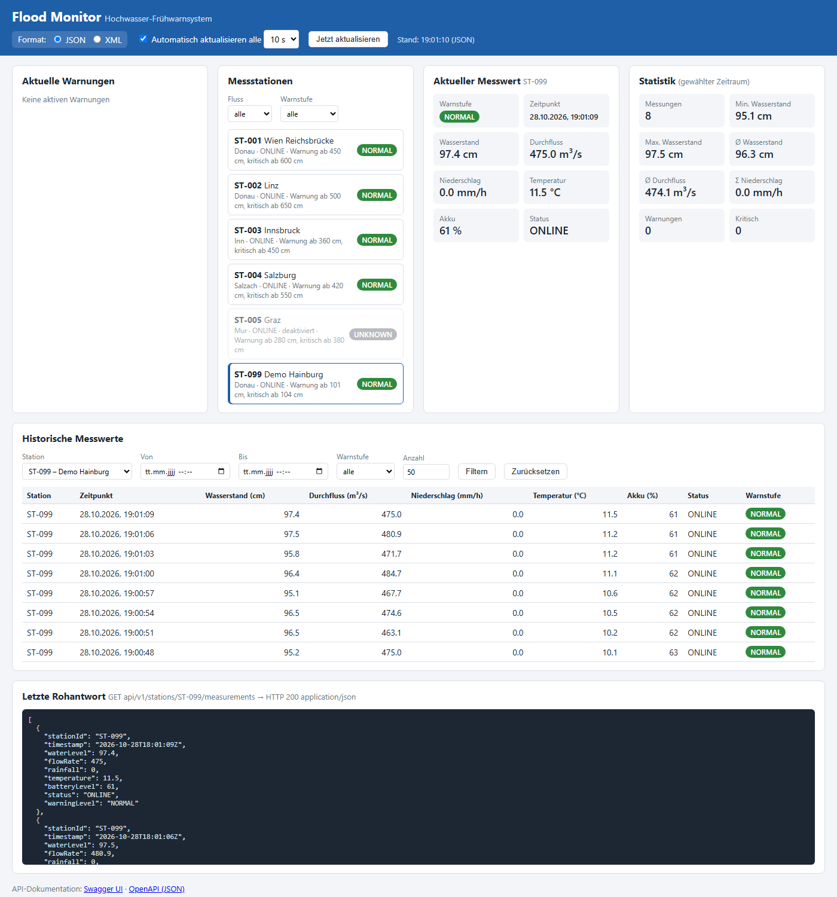
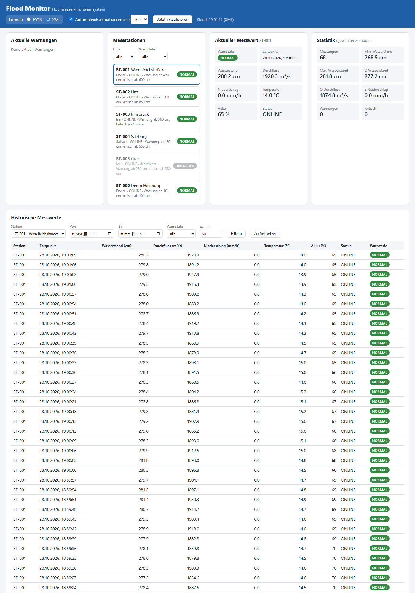
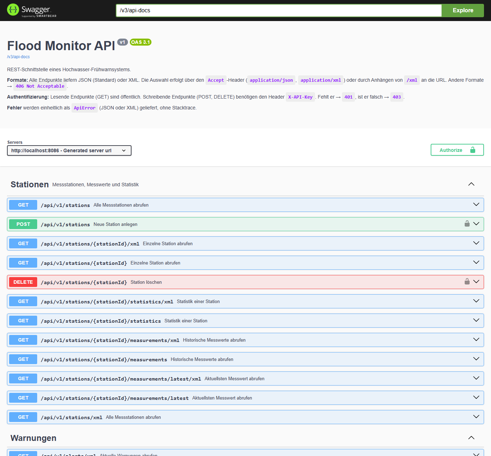

# Flood Monitor – REST-Schnittstelle für ein Hochwasser-Frühwarnsystem

Spring-Boot-Anwendung, die Messstationen simuliert und deren Messwerte über eine REST-Schnittstelle
in **JSON** und **XML** bereitstellt. Die Aufgabenstellung steht in [TASK.md](TASK.md), eine Erklärung des
wichtigsten Codes Schritt für Schritt in [dokumentation.md](dokumentation.md).

## Inhalt der Abgabe

| Gefordert | Wo |
|---|---|
| vollständiger Quellcode | [`src/main/java`](src/main/java/com/example/floodmonitor), Webclient in [`src/main/resources/static`](src/main/resources/static) |
| README.md | diese Datei |
| Build-Konfiguration | [`build.gradle`](build.gradle), [`settings.gradle`](settings.gradle), Gradle Wrapper (`gradlew`, `gradlew.bat`) |
| Konfigurationsbeispiel ohne geheime Zugangsdaten | [`application.example.properties`](application.example.properties), [`application.properties`](src/main/resources/application.properties) – [Konfiguration](#konfiguration-srcmainresourcesapplicationproperties) |
| automatisierte Tests | [`src/test`](src/test/java/com/example/floodmonitor) – [Automatisierte Tests](#automatisierte-tests) |
| API-Dokumentation | [`docs/openapi.yaml`](docs/openapi.yaml), [`docs/openapi.json`](docs/openapi.json), live unter `/swagger-ui.html` – [API-Dokumentation](#api-dokumentation-openapi) |
| Architektur- und Datenmodellbeschreibung | [Architektur](#architektur), [Datenmodell](#datenmodell) |
| Dokumentation der Simulationsregeln | [Simulationsregeln](#simulationsregeln), [Warnstufen](#warnstufen) |
| Startanleitung | [Start](#start) |
| Beispiele für JSON- und XML-Anfragen | [JSON und XML](#json-und-xml-content-negotiation) |
| Screenshots des Webclients | [`docs/screenshots`](docs/screenshots) – [Screenshots](#screenshots) |
| kurze Reflexion | [Reflexion](#reflexion) |
| Fragestellungen (mit Quellen) | [Fragestellungen](#fragestellungen) |
| Dokumentation der AI-Prompts | [AI-Prompts](#dokumentation-der-ai-prompts) |

## Start

Voraussetzung: Java 17 oder neuer (Gradle Wrapper ist enthalten).

```bash
./gradlew bootRun          # Windows: gradlew.bat bootRun
./gradlew test             # automatisierte Tests
```

Nach dem Start:

| URL | Inhalt |
|---|---|
| http://localhost:8080/ | Webclient |
| http://localhost:8080/api/v1/stations | API (Basis-URL `/api/v1`) |
| http://localhost:8080/swagger-ui.html | API-Dokumentation (Swagger UI) |
| http://localhost:8080/v3/api-docs | OpenAPI-Beschreibung als JSON (`/v3/api-docs.yaml` als YAML) |

### Konfiguration (`src/main/resources/application.properties`)

| Property | Standard | Bedeutung |
|---|---:|---|
| `simulation.interval` | `10000` | Intervall zwischen zwei Messungen (ms) |
| `simulation.enabled` | `true` | Simulation an/aus (in Tests `false`) |
| `simulation.history-size` | `60` | Anzahl der beim Start rückwirkend erzeugten Messungen pro Station |
| `warning.stale-after-intervals` | `3` | Ab diesem Alter (in Intervallen) gilt die letzte Messung als veraltet → `UNKNOWN` |
| `api.key` | `${FLOODMONITOR_API_KEY:dev-key-change-me}` | API-Key für schreibende Zugriffe |

Werte lassen sich auch beim Start überschreiben, z. B. `./gradlew bootRun --args="--simulation.interval=2000"`.

Die Datei enthält **keine geheimen Zugangsdaten**: Der API-Key wird aus der Umgebungsvariable
`FLOODMONITOR_API_KEY` gelesen, `dev-key-change-me` ist nur ein Platzhalter für die lokale Entwicklung.

```bash
FLOODMONITOR_API_KEY=mein-geheimer-key ./gradlew bootRun      # Linux/macOS
$env:FLOODMONITOR_API_KEY="mein-geheimer-key"; .\gradlew.bat bootRun   # PowerShell
```

Eine kommentierte Vorlage aller Einstellungen liegt in [`application.example.properties`](application.example.properties).

## Architektur

```
com.example.floodmonitor
├── model/        Station, Location, Measurement, Alert, Statistics, ApiError, StationRequest,
│                 Enums WarningLevel, StationStatus
├── repository/   StationRepository, MeasurementRepository (In-Memory)
├── service/      StationService, MeasurementService, AlertService,
│                 WarningLevelService (Warnstufen), MeasurementSimulator (Regeln),
│                 SimulationScheduler (zeitgesteuerte Simulation)
├── controller/   StationController, AlertController (nur HTTP, keine Geschäftslogik)
├── exception/    GlobalExceptionHandler (@RestControllerAdvice) + eigene Exceptions
└── config/       WebConfig (Content Negotiation, XML-Deklaration, Interceptor-Registrierung),
                  ApiKeyInterceptor (Authentifizierung), OpenApiConfig (OpenAPI-Metadaten)

src/main/resources/static/   Webclient: index.html, css/style.css, js/app.js (jQuery als WebJar)
```

Ablauf einer Anfrage: **Controller** (nimmt Parameter entgegen) → **Service** (Validierung, Filter,
Berechnungen) → **Repository** (Daten im Speicher). Fehler werden als Exception geworfen und zentral im
`GlobalExceptionHandler` in eine `ApiError`-Antwort mit passendem Statuscode übersetzt.
Der `SimulationScheduler` ruft periodisch `MeasurementService.simulateTick()` auf, der mit dem
`MeasurementSimulator` neue Messungen erzeugt und mit dem `WarningLevelService` deren Warnstufe berechnet.

```text
Browser (index.html + app.js) ──HTTP GET, Accept: JSON/XML──▶ Controller ──▶ Service ──▶ Repository
                                                                   ▲
                               SimulationScheduler ──(alle N ms)───┘ MeasurementSimulator, WarningLevelService
```

## Datenmodell

**Station:** `id`, `name`, `river`, `location` (`latitude`, `longitude`), `normalWaterLevel`,
`warningWaterLevel`, `criticalWaterLevel` (alle in cm), `isActive`, `status` (`ONLINE`, `MAINTENANCE`, `OFFLINE`)
und die serverseitig berechnete `currentWarningLevel`.

**Measurement:** `stationId`, `timestamp` (`java.time.Instant`, ISO-8601 in UTC), `waterLevel` (cm),
`flowRate` (m³/s), `rainfall` (mm/h), `temperature` (°C), `batteryLevel` (%), `status`, `warningLevel`.

Vorhandene Stationen:

| ID | Name | Fluss | Normal / Warnung / Kritisch (cm) | aktiv |
|---|---|---|---|---|
| ST-001 | Wien Reichsbrücke | Donau | 280 / 450 / 600 | ja |
| ST-002 | Linz | Donau | 330 / 500 / 650 | ja |
| ST-003 | Innsbruck | Inn | 220 / 360 / 450 | ja |
| ST-004 | Salzburg | Salzach | 250 / 420 / 550 | ja |
| ST-005 | Graz | Mur | 150 / 280 / 380 | nein |

## Simulationsregeln

Jede neue Messung wird aus der **vorherigen Messung** derselben Station berechnet (`MeasurementSimulator`):

- **Niederschlag** (Markov-Kette): Ohne Regen beginnt mit 4 % Wahrscheinlichkeit eine Regenphase
  (davon 20 % Starkregen mit 10–25 mm/h, sonst 0,5–6,5 mm/h). Während Regen endet er mit 5 % Wahrscheinlichkeit,
  sonst ändert sich die Intensität leicht (×0,85…1,18 ± Rauschen, maximal 60 mm/h).
- **Wasserstand:** `Δ = 0,8 · Niederschlag · Dämpfung − 0,06 · (Wasserstand − Normalwasserstand) + Rauschen(σ = 1 cm)`.
  Regen hebt den Pegel, ohne Regen sinkt er langsam zum Normalwert zurück. Die Änderung ist auf ±25 cm
  pro Messung begrenzt, der Wasserstand ist nie negativ.
- **Dämpfung:** Unterhalb des Warnwerts wirkt Regen voll (Dämpfung = 1). Darüber nimmt die Wirkung linear ab
  und erreicht beim Höchststand `kritisch + 0,5 · (kritisch − Warnwert)` den Wert 0 (Wasser verteilt sich auf
  Überflutungsflächen). Ohne diese Regel stieg der Pegel bei langem Starkregen auf das Doppelte des kritischen
  Werts (siehe Reflexion). In einer Langzeitsimulation (100 000 Messungen, Station Innsbruck) liegen so
  ca. 7 % der Messungen bei `WARNING` und ca. 0,4 % bei `CRITICAL`.
- **Durchflussmenge:** `mittlerer Durchfluss · (Wasserstand / Normalwasserstand)^1,5` ± 1 %
  → steigt überproportional mit dem Wasserstand.
- **Temperatur:** Zufallsbewegung um die typische Standorttemperatur, bei Regen leicht sinkend.
- **Akku / Status:** Der Akku sinkt pro Messung mit 30 % Wahrscheinlichkeit um 1 % (Bereich 0–100).
  Unter 15 % wechselt die Station auf `MAINTENANCE`; in diesem Zustand wird der Akku pro Messung mit
  15 % Wahrscheinlichkeit getauscht (→ 100 %, `ONLINE`). Bei 0 % fällt die Station aus (`OFFLINE`).
- Für **deaktivierte** (`isActive = false`) oder **ausgefallene** (`OFFLINE`) Stationen werden keine Messungen erzeugt.
- Beim Start wird eine Historie von `simulation.history-size` Messungen rückwirkend erzeugt.

## Warnstufen

Die Warnstufe wird ausschließlich serverseitig berechnet (`WarningLevelService`), in dieser Reihenfolge:

| Bedingung | Warnstufe |
|---|---|
| keine Messung oder ungültiger Wasserstand (negativ / NaN) | `UNKNOWN` |
| Wasserstand ≥ kritischer Wert | `CRITICAL` |
| Wasserstand ≥ Warnwert | `WARNING` |
| **Frühwarnung:** Wasserstand ≥ 90 % des Warnwerts **und** Anstieg ≥ 10 cm seit der letzten Messung **und** Niederschlag ≥ 10 mm/h | `WARNING` |
| sonst | `NORMAL` |

Für die aktuelle Warnstufe einer Station (`currentWarningLevel`, Filter, Alerts) gilt zusätzlich:
Ist die letzte Messung älter als `warning.stale-after-intervals × simulation.interval`, ist sie nicht mehr
aktuell → `UNKNOWN`.

## REST-Schnittstelle

| Methode | Endpunkt | Parameter | Auth |
|---|---|---|---|
| GET | `/api/v1/stations` | `river`, `isActive`, `warningLevel` | – |
| GET | `/api/v1/stations/{stationId}` | | – |
| GET | `/api/v1/stations/{stationId}/measurements/latest` | | – |
| GET | `/api/v1/stations/{stationId}/measurements` | `from`, `to`, `limit`, `warningLevel` | – |
| GET | `/api/v1/stations/{stationId}/statistics` | `from`, `to` | – |
| GET | `/api/v1/alerts` | `warningLevel`, `river` | – |
| POST | `/api/v1/stations` | Body: Station (JSON oder XML) → `201 Created` + `Location` | `X-API-Key` |
| DELETE | `/api/v1/stations/{stationId}` | → `204 No Content` | `X-API-Key` |

- Alle Filter sind optional. `river` ignoriert Groß-/Kleinschreibung.
- `from`/`to` im ISO-8601-Format, z. B. `2026-05-01T08:00:00Z` (beide Grenzen inklusive).
- `limit`: 1–1000, Standard 100. Historische Messwerte werden **neueste zuerst** geliefert.
- **Alerts** sind aktive Stationen, deren aktuelle Warnstufe `WARNING` oder `CRITICAL` ist (kritische zuerst).
- **Statistik:** `measurementCount`, `minWaterLevel`, `maxWaterLevel`, `avgWaterLevel`, `avgFlowRate`,
  `rainfallSum` (Summe der Niederschlagswerte), `warningCount` (Messungen mit `WARNING` oder `CRITICAL`),
  `criticalCount` (Messungen mit `CRITICAL`).

### Fehler

| Situation | Status |
|---|---:|
| Anfrage erfolgreich | 200 |
| Station angelegt (POST) | 201 |
| Station gelöscht (DELETE) | 204 |
| `from` nach `to`, ungültiges Datum, ungültige Warnstufe, `limit` außerhalb 1–1000, ungültiger/fehlender Body | 400 |
| schreibender Zugriff ohne `X-API-Key` | 401 (+ `WWW-Authenticate`) |
| schreibender Zugriff mit falschem `X-API-Key` | 403 |
| unbekannte Station / Station ohne Messung / unbekannter Pfad | 404 |
| `Accept` weder JSON noch XML | 406 (ohne Body) |
| Station mit dieser ID existiert bereits | 409 |
| `Content-Type` des Bodys weder JSON noch XML | 415 |
| unerwarteter Fehler | 500 (ohne Stacktrace) |

Fehler werden (je nach `Accept`) als JSON oder XML geliefert:

```json
{
  "timestamp": "2026-05-01T10:20:00Z",
  "status": 404,
  "error": "Not Found",
  "message": "Station ST-999 wurde nicht gefunden",
  "path": "/api/v1/stations/ST-999"
}
```

## JSON und XML (Content Negotiation)

Standardmäßig wird **JSON** geliefert. **XML** bekommt man, indem man an die URL `/xml` anhängt –
das funktioniert bei jedem Endpunkt, auch zusammen mit Query-Parametern und bei Fehlerantworten:

```text
http://localhost:8080/api/v1/stations                              → JSON
http://localhost:8080/api/v1/stations/xml                          → XML
http://localhost:8080/api/v1/stations/ST-001/measurements/latest/xml
http://localhost:8080/api/v1/stations/ST-001/measurements/xml?limit=10
http://localhost:8080/api/v1/alerts/xml?river=Donau
```

Reihenfolge der Formatwahl:

1. URL endet auf `/xml` → XML
2. `Accept`-Header (`application/json` / `application/xml`; anderes Format → `406`).
   Browser-Aufrufe (Accept enthält `text/html`) werden dabei ignoriert, damit der Browser ohne `/xml` JSON zeigt.
3. sonst JSON

```bash
curl http://localhost:8080/api/v1/stations/ST-001/measurements/latest
curl http://localhost:8080/api/v1/stations/ST-001/measurements/latest/xml
curl -H "Accept: application/xml" http://localhost:8080/api/v1/stations/ST-001/measurements/latest
curl "http://localhost:8080/api/v1/stations/ST-001/measurements?from=2026-05-01T08:00:00Z&to=2026-05-01T12:00:00Z&limit=100"
curl "http://localhost:8080/api/v1/alerts?river=Donau&warningLevel=CRITICAL"
curl -H "Accept: text/plain" -i http://localhost:8080/api/v1/stations   # 406
```

JSON:

```json
{
  "stationId": "ST-001",
  "timestamp": "2026-05-01T10:15:00Z",
  "waterLevel": 318.4,
  "flowRate": 742.6,
  "rainfall": 12.7,
  "temperature": 14.3,
  "batteryLevel": 87,
  "status": "ONLINE",
  "warningLevel": "WARNING"
}
```

XML:

```xml
<?xml version='1.0' encoding='UTF-8'?>
<measurement>
  <stationId>ST-001</stationId>
  <timestamp>2026-05-01T10:15:00Z</timestamp>
  <waterLevel>318.4</waterLevel>
  <flowRate>742.6</flowRate>
  <rainfall>12.7</rainfall>
  <temperature>14.3</temperature>
  <batteryLevel>87</batteryLevel>
  <status>ONLINE</status>
  <warningLevel>WARNING</warningLevel>
</measurement>
```

Listen werden in XML als `<List><item>…</item></List>` ausgegeben (Standardverhalten von Jackson XML),
die einzelnen Elemente enthalten dieselben Felder wie im JSON.

Beispiel für schreibende Anfragen (JSON oder XML):

```bash
curl -i -X POST http://localhost:8080/api/v1/stations \
  -H "X-API-Key: dev-key-change-me" -H "Content-Type: application/json" \
  -d '{"id":"ST-100","name":"Krems","river":"Donau","location":{"latitude":48.41,"longitude":15.6},
       "normalWaterLevel":300,"warningWaterLevel":480,"criticalWaterLevel":620,"isActive":true}'
# → 201 Created, Location: http://localhost:8080/api/v1/stations/ST-100

curl -i -X POST http://localhost:8080/api/v1/stations \
  -H "X-API-Key: dev-key-change-me" -H "Content-Type: application/xml" -H "Accept: application/xml" \
  -d '<station><id>ST-101</id><name>Hall</name><river>Inn</river>
      <location><latitude>47.28</latitude><longitude>11.5</longitude></location>
      <normalWaterLevel>200</normalWaterLevel><warningWaterLevel>340</warningWaterLevel>
      <criticalWaterLevel>430</criticalWaterLevel></station>'

curl -i -X DELETE http://localhost:8080/api/v1/stations/ST-100 -H "X-API-Key: dev-key-change-me"   # 204
curl -i -X DELETE http://localhost:8080/api/v1/stations/ST-001                                      # 401
curl -i -X DELETE http://localhost:8080/api/v1/stations/ST-001 -H "X-API-Key: falsch"               # 403
```

## Sicherheit

- **Authentifizierung:** Lesende Anfragen (GET) sind öffentlich – Messwerte eines Frühwarnsystems sollen
  alle abrufen können. Schreibende Anfragen (POST, DELETE) prüft der `ApiKeyInterceptor` anhand des Headers
  `X-API-Key`: fehlt er → `401 Unauthorized` (mit `WWW-Authenticate`-Header), ist er falsch → `403 Forbidden`.
  Der Vergleich erfolgt in konstanter Zeit (`MessageDigest.isEqual`), um Timing-Angriffe zu erschweren.
- **Keine Geheimnisse im Repository:** Der Key kommt aus der Umgebungsvariable `FLOODMONITOR_API_KEY`.
- **Eingabevalidierung:** Alle Query-Parameter und Request-Bodies werden geprüft (Typ, Wertebereich,
  `from ≤ to`, `limit ≤ 1000`, Schwellwerte `normal < warning < critical`), ungültige Eingaben → `400`.
- **Begrenzung:** `limit` ist auf 1000 beschränkt, pro Station werden maximal 10 000 Messungen gespeichert.
- **Keine internen Details:** Fehlerantworten enthalten nie Stacktraces oder Exception-Texte
  (`server.error.include-stacktrace=never`, eigener `GlobalExceptionHandler` mit `500 Interner Serverfehler`).
- **Warnstufe nur serverseitig:** Der Client kann `warningLevel`/`status` nicht setzen
  (`StationRequest` enthält diese Felder nicht).
- **XSS im Webclient:** Alle Werte aus der API werden vor dem Einfügen ins HTML escaped.

Grenzen: Der API-Key wird ohne HTTPS im Klartext übertragen. Im echten Betrieb müsste die Anwendung hinter
TLS laufen, und für mehrere Benutzer wären OAuth2/JWT mit Spring Security besser geeignet.

## API-Dokumentation (OpenAPI)

Die API ist mit **springdoc-openapi** dokumentiert. Die Beschreibung wird aus den Controllern und den
Annotationen (`@Operation`, `@Parameter`, `@ApiResponse`, `@Tag`) erzeugt und enthält Endpunkte, Methoden,
Parameter, Request- und Response-Bodies (Schemas für `Station`, `Measurement`, `Alert`, `Statistics`,
`ApiError`, `StationRequest`), Formate (`application/json`, `application/xml`), Statuscodes, Fehlerantworten
und das Sicherheitsschema `apiKey` (Header `X-API-Key`).

- Swagger UI: http://localhost:8080/swagger-ui.html (dort über **Authorize** den API-Key eintragen)
- OpenAPI JSON: http://localhost:8080/v3/api-docs
- OpenAPI YAML: http://localhost:8080/v3/api-docs.yaml
- Exportierte Fassung im Repository (ohne laufenden Server lesbar): [`docs/openapi.yaml`](docs/openapi.yaml), [`docs/openapi.json`](docs/openapi.json)

Die `/xml`-Kurzformen der URLs sind in der Beschreibung erwähnt, aber nicht als eigene Pfade gelistet.

## Webclient

Der Client liegt unter `src/main/resources/static/` und wird von Spring Boot unter http://localhost:8080/
ausgeliefert (HTML, CSS, jQuery 3.6.1 als WebJar – keine Internetverbindung nötig). Er

- lädt alle **Stationen** (Filter nach Fluss und aktueller Warnstufe) und die **aktuellen Warnungen**,
- zeigt den **aktuellen Messwert** und die **Statistik** der gewählten Station,
- zeigt **historische Messwerte** in einer Tabelle (Station, Zeitpunkt, Wasserstand, Durchfluss, Niederschlag,
  Temperatur, Akkustand, Stationsstatus, Warnstufe), filterbar nach **Zeitraum**, **Warnstufe** und Anzahl,
- schaltet zwischen **JSON und XML** um: Es wird nur der `Accept`-Header geändert. Die XML-Antwort wird mit
  `$.parseXML` gelesen und in dieselbe Objektstruktur wie JSON umgewandelt, daher ist die Darstellung identisch.
  Die zuletzt empfangene Rohantwort wird unten angezeigt,
- **aktualisiert periodisch** (5/10/30/60 s, abschaltbar),
- zeigt einen **Ladeindikator** und **verständliche Fehlermeldungen** (Server nicht erreichbar, Zeitüberschreitung,
  `message` aus der `ApiError`-Antwort, Prüfung von Zeitraum und Anzahl schon im Client),
- färbt `NORMAL` grün, `WARNING` orange, `CRITICAL` rot und `UNKNOWN` grau.

Ansichten lassen sich per URL vorbelegen, z. B. http://localhost:8080/?station=ST-002&format=xml

### Screenshots

Übersicht (JSON) – die Station ST-099 wurde zur Demonstration per `POST` angelegt:



Station ST-001 im XML-Modus (die Rohantwort unten zeigt das empfangene XML):



Swagger UI:



## Automatisierte Tests

`./gradlew test` – die Simulation ist in Tests abgeschaltet (`src/test/resources/application.properties`:
`simulation.enabled=false`). Die Testdaten werden in jedem Test fest angelegt, Zufallstests nutzen einen festen
Seed (z. B. `new Random(42)`) – die Tests sind daher deterministisch.

| Anforderung | Test |
|---|---|
| Alle Stationen als JSON | `FloodMonitorApiTest.stationsAsJsonByDefault` |
| Alle Stationen als XML | `stationsAsXml`, `xmlSuffixReturnsXml` |
| Existierende Station | `existingStation` |
| Unbekannte Station | `unknownStation`, `unknownStationAsXml` |
| Aktuellster Messwert | `latestMeasurement`, `latestMeasurementAsXml` |
| Filterung nach Zeitraum | `filterByTimeRange` |
| Ungültiger Zeitraum / Datumsformat | `fromAfterToIsRejected`, `invalidDateFormatIsRejected` |
| Warnstufe NORMAL / WARNING / CRITICAL | `warningLevelsAreCalculatedServerSide`, `SimulationRulesTest.warningLevelThresholds` |
| Nicht unterstütztes Format | `unsupportedFormat` (406) |
| Maximales Limit | `limitBounds` (1000 ok, 1001 und -1 → 400) |
| Filter Stationen / Alerts, Statistik | `stationFilters`, `alerts`, `statistics` |
| 201 / 204 / 401 / 403 / 409 / 415 | `StationWriteApiTest` |
| OpenAPI-Dokumentation, Webclient erreichbar | `openApiDocumentationIsAvailable`, `webclientIsServed` |
| Simulationsregeln | `SimulationRulesTest` (Wertebereiche, Regen → Pegel/Durchfluss, Akku → MAINTENANCE) |

## Fragestellungen

**1. Was sind die Hauptmerkmale von JSON?**
JSON (JavaScript Object Notation) ist ein textbasiertes, sprachunabhängiges Datenaustauschformat. Es kennt
vier primitive Typen (String, Zahl, Boolean, `null`) und zwei strukturierte Typen (Objekt = ungeordnete
Name/Wert-Paare in `{}`, Array = geordnete Liste in `[]`). Es ist kompakt, gut von Menschen lesbar, wird
in UTF-8 übertragen und lässt sich in JavaScript direkt verarbeiten. Es gibt keine Kommentare, keine Attribute
und keine Namespaces; ein Schema (JSON Schema) ist optional.
*Quellen:* [RFC 8259 – The JSON Data Interchange Format](https://www.rfc-editor.org/rfc/rfc8259),
[json.org](https://www.json.org/json-de.html)

**2. Was sind die Hauptmerkmale von XML?**
XML (Extensible Markup Language) ist eine Auszeichnungssprache für hierarchisch strukturierte Daten.
Daten stehen in selbst definierten Elementen (`<waterLevel>318.4</waterLevel>`), die Attribute haben können.
Ein Dokument muss *wohlgeformt* sein (genau ein Wurzelelement, korrekt verschachtelte und geschlossene Tags)
und kann gegen eine DTD oder ein XML Schema *validiert* werden. XML unterstützt Namespaces, Kommentare und
eine Deklaration mit Encoding (`<?xml version="1.0" encoding="UTF-8"?>`). Alle Werte sind Text – Datentypen
ergeben sich erst aus einem Schema. XML ist ausführlicher (größer) als JSON.
*Quellen:* [W3C – Extensible Markup Language (XML) 1.0](https://www.w3.org/TR/xml/),
[W3C – XML Schema](https://www.w3.org/XML/Schema)

**3. Wie unterscheidet die Applikation, ob JSON oder XML zurückgegeben wird?**
Über **Content Negotiation** von Spring MVC. Die Controller geben nur Java-Objekte zurück und deklarieren
`produces = {application/json, application/xml}`. Spring wählt anhand der vom Client gewünschten Medientypen
einen passenden `HttpMessageConverter` (`MappingJackson2HttpMessageConverter` für JSON,
`MappingJackson2XmlHttpMessageConverter` für XML – vorhanden, weil `jackson-dataformat-xml` im Classpath ist).
Die gewünschten Medientypen bestimmt in diesem Projekt die Konfiguration in `WebConfig`:
1. URL endet auf `/xml` → XML,
2. sonst der `Accept`-Header (`application/json` / `application/xml`), Browser-Aufrufe ausgenommen,
3. sonst JSON (Standard).

Akzeptiert der Client keines der beiden Formate, wirft Spring `HttpMediaTypeNotAcceptableException` → `406`.
*Quellen:* [Spring Framework Reference – Content Types](https://docs.spring.io/spring-framework/reference/web/webmvc/mvc-config/content-negotiation.html),
[MDN – Content negotiation](https://developer.mozilla.org/en-US/docs/Web/HTTP/Guides/Content_negotiation)

**4. Was zeichnet ein REST-Interface aus und warum wird es so oft verwendet?**
REST (Representational State Transfer, Roy Fielding 2000) ist ein Architekturstil mit den Bedingungen
Client-Server, **Zustandslosigkeit** (jede Anfrage enthält alle nötigen Informationen), **Cachebarkeit**,
**einheitliche Schnittstelle** (Ressourcen über URIs identifiziert, Manipulation über Repräsentationen wie
JSON/XML, selbstbeschreibende Nachrichten, HATEOAS), **Schichtenarchitektur** und optional Code-on-Demand.
In der Praxis bedeutet das: Ressourcen als URLs (`/stations/ST-001/measurements`), Standard-HTTP-Methoden
und -Statuscodes. Verbreitet ist REST, weil es auf HTTP aufbaut (überall verfügbar, firewallfreundlich,
von jeder Programmiersprache nutzbar), leichtgewichtig ist, Caching und Proxies der Web-Infrastruktur nutzt,
dank Zustandslosigkeit gut skaliert und Client und Server lose koppelt.
*Quellen:* [R. Fielding – Dissertation, Kapitel 5: REST](https://ics.uci.edu/~fielding/pubs/dissertation/rest_arch_style.htm),
[MDN – REST](https://developer.mozilla.org/en-US/docs/Glossary/REST)

**5. Unterschied zwischen GET, POST, PUT und PATCH?**

| Methode | Zweck | sicher | idempotent |
|---|---|---|---|
| GET | Repräsentation einer Ressource lesen, keine Änderung | ja | ja |
| POST | Daten zur Verarbeitung senden, meist neue Ressource anlegen (`201` + `Location`) | nein | nein |
| PUT | Ressource an der angegebenen URI vollständig ersetzen bzw. anlegen | nein | ja |
| PATCH | Ressource teilweise ändern (nur die mitgeschickten Änderungen) | nein | nicht garantiert |

*Sicher* = ändert keinen Zustand auf dem Server; *idempotent* = mehrfaches Senden hat dieselbe Wirkung wie
einmaliges Senden.
*Quellen:* [RFC 9110 – HTTP Semantics, Kap. 9](https://www.rfc-editor.org/rfc/rfc9110#name-methods),
[RFC 5789 – PATCH Method for HTTP](https://www.rfc-editor.org/rfc/rfc5789)

**6. Welche Stellen muss ich für eine neue Request-Methode / einen neuen Pfad ändern?**
1. **Controller:** neue Methode mit `@GetMapping`/`@PostMapping`/… und Pfad, Parameter mit `@PathVariable`,
   `@RequestParam` oder `@RequestBody` (ggf. neuer Controller mit `@RestController`).
2. **Service:** die Geschäftslogik (Validierung, Berechnung) – der Controller ruft nur den Service auf.
3. **Repository:** falls neue Datenzugriffe nötig sind.
4. **Model:** neue Request-/Response-Klassen (mit `@JacksonXmlRootElement` für XML).
5. **Exception Handling:** neue Fehlerfälle als Exception + Handler im `GlobalExceptionHandler`.
6. **Sicherheit:** Bei schreibenden Methoden greift der `ApiKeyInterceptor` automatisch (alle Nicht-GET unter `/api/**`).
7. **OpenAPI-Annotationen** (`@Operation`, `@ApiResponse`), **Tests**, ggf. den **Webclient** (`app.js`) und die README.

*Quelle:* [Spring Guide – Building a RESTful Web Service](https://spring.io/guides/gs/rest-service/)

**7. Kann man OpenAPI und Swagger vergleichen?**
Nur eingeschränkt, weil es verschiedene Dinge sind, die eng zusammenhängen. **OpenAPI** ist eine
**Spezifikation** (ein Standard, betreut von der OpenAPI Initiative unter der Linux Foundation), die festlegt,
wie eine HTTP-API maschinenlesbar in JSON oder YAML beschrieben wird (Pfade, Parameter, Schemas, Antworten,
Security). **Swagger** war der ursprüngliche Name dieser Spezifikation (bis Swagger 2.0); 2015 wurde sie von
SmartBear an die OpenAPI Initiative übergeben und ab Version 3.0 in „OpenAPI Specification“ umbenannt.
Heute bezeichnet **Swagger** die **Werkzeuge** von SmartBear rund um OpenAPI: Swagger UI (interaktive
Dokumentation – in diesem Projekt unter `/swagger-ui.html`), Swagger Editor, Swagger Codegen.
Kurz: OpenAPI = *das Format bzw. der Standard*, Swagger = *Tools, die mit diesem Format arbeiten*
(plus der historische Name der Spezifikation).
*Quellen:* [Swagger Blog – What Is the Difference Between Swagger and OpenAPI?](https://swagger.io/blog/api-strategy/difference-between-swagger-and-openapi/),
[OpenAPI Specification](https://spec.openapis.org/oas/latest.html)

**8. Fehler im Code-Snippet**

```java
@GetMapping("/stations/add")
public String createStation(@RequestParam String name, @RequestParam double warning) {
    stationService.save(new Station(name, warning));
    return "Station successfully created!";
}
```

- **Falsche HTTP-Methode (Hauptfehler):** Es wird eine Ressource angelegt, aber `GET` verwendet. GET muss
  *sicher* und *idempotent* sein (RFC 9110). Browser-Prefetching, Crawler, Caches oder ein Neuladen der Seite
  würden ungewollt Stationen anlegen; Daten in der URL landen außerdem in Logs und der Browser-History.
  Richtig: `@PostMapping("/stations")`.
- **Verb im Pfad:** `/stations/add` ist nicht RESTful – die Aktion ergibt sich aus der Methode, der Pfad
  bezeichnet nur die Ressource (`POST /api/v1/stations`).
- **Falsche Antwort:** Es kommt `200 OK` mit einem Text zurück statt `201 Created` mit `Location`-Header und der
  angelegten Station als JSON/XML; der Text ist nicht maschinenlesbar und nicht per Content Negotiation steuerbar.
- **Daten als Query-Parameter statt Request-Body** (`@RequestBody` mit JSON/XML).
- **Keine Validierung / unvollständige Daten:** fehlende ID, kein Fluss, keine Position, kein kritischer Wert;
  `warning` wird nicht geprüft (negativ?). Ungültige Eingaben müssten `400` liefern, doppelte IDs `409`.
- **Keine Authentifizierung** für eine schreibende Operation.

*Quellen:* [RFC 9110 – Safe Methods](https://www.rfc-editor.org/rfc/rfc9110#name-safe-methods),
[RFC 9110 – 201 Created](https://www.rfc-editor.org/rfc/rfc9110#name-201-created)

Die korrigierte Variante ist in diesem Projekt `StationController.createStation` (`POST /api/v1/stations`).

## Dokumentation der AI-Prompts

Für dieses Projekt wurde **Claude Code** (Anthropic) eingesetzt.

| # | Prompt | Ergebnis |
|---|---|---|
| 1 | *(frühere Prompts zu Datenmodell, Simulation, Warnstufen, REST-Endpunkten, Content Negotiation, Fehlerbehandlung und Tests hier ergänzen)* | |
| 2 | „Bitte schau, was bei dieser Aufgabenstellung schon umgesetzt wurde und was noch fehlt, und ergänze, kein github/git auch wenn gefordert:“ + vollständige Aufgabenstellung | Analyse des Stands; ergänzt wurden Webclient, OpenAPI/Swagger, API-Key-Authentifizierung, POST/DELETE (201/204/401/403/409/415) mit Tests, Korrektur der Simulation (unrealistisch hohe Pegel), Screenshots und die README-Abschnitte Sicherheit, OpenAPI, Webclient, Tests, Fragestellungen und Reflexion |
| 3 | „bitte erstelle auch eine dokumentation.md datei welche den hauptcode (logik/wichtiger code) von jedem schritt hinschreibt …, darunter in 1-2 leichten sätzen schreibt was der code macht“ | [dokumentation.md](dokumentation.md) mit Code-Auszügen und kurzen Erklärungen zu allen Schritten |
| 4 | „wir müssen das ganze Ding jetzt noch kurz abgabeready machen“ + Liste der Abgabe-Inhalte | Abgabe-Übersicht in der README, `application.example.properties`, exportierte OpenAPI-Dateien in `docs/`, Fix für `/v3/api-docs.yaml` (lieferte 406), Aufräumen (`.DS_Store`) |

Alle von der KI erzeugten Teile wurden gelesen, mit `./gradlew test` geprüft und im laufenden Webclient getestet.

## Reflexion

- **Browser bekam XML statt JSON:** Browser senden `Accept: text/html,…,application/xml;q=0.9,*/*`, daher
  wählte Spring XML. Gelöst mit einer eigenen Strategie, die Browser-Accept-Header ignoriert, plus der
  `/xml`-Kurzform für den Browser.
- **XML-Listen:** Jackson XML gibt Listen als `<List><item>…</item></List>` aus. Der Webclient muss das beim
  Umwandeln in JS-Objekte berücksichtigen; außerdem kennt XML keine Datentypen, Zahlen und Booleans müssen im
  Client zurückgewandelt werden.
- **Unrealistische Simulation:** Ein Screenshot zeigte Innsbruck mit 873 cm (kritisch ab 450 cm). Ursache:
  Die Regenintensität stieg im Mittel bei jeder Messung (Faktor Ø 1,025), und Regen hob den Pegel unbegrenzt.
  Gelöst durch einen etwas kleineren Faktor und eine Dämpfung oberhalb des Warnwerts. Mit einer Langzeitsimulation
  (100 000 Messungen) wurden die Parameter so gewählt, dass WARNING und CRITICAL vorkommen, aber selten sind.
- **Deterministische Tests trotz Zufall:** Simulation in Tests abgeschaltet, Testdaten manuell angelegt,
  der Simulator bekommt ein `Random` mit festem Seed.
- **Abhängigkeiten:** springdoc-openapi 2.8 benötigt Spring Boot ≥ 3.4, daher wurde Spring Boot von 3.2.0
  auf 3.5.7 aktualisiert.
- **Veraltete Messungen:** Eine deaktivierte Station hätte sonst dauerhaft ihre letzte Warnstufe behalten –
  deshalb gilt eine Messung nach drei Intervallen als veraltet (`UNKNOWN`).
